<a href="https://yashaswinsharma.vercel.app/"><picture><source media="(prefers-color-scheme: dark)" srcset="assets/hero-dark.svg"></picture></a>

I'm a CS undergraduate at Woxsen University in Hyderabad. I build ML systems from the lowest layer up, and I test what can be read from a model's activations.

<picture><source media="(prefers-color-scheme: dark)" srcset="assets/now-dark.svg"></picture> 
<a href="https://github.com/puranikyashaswin/ferrotensor"><b>ferrotensor</b></a>&ensp;a GPU ML framework in Rust, with LoRA fine-tuning 
<a href="https://github.com/puranikyashaswin/hackprobe"><b>hackprobe</b></a>&ensp;activations give no earlier warning of test-gaming than text

<picture><source media="(prefers-color-scheme: dark)" srcset="assets/research-dark.svg"></picture> 
<a href="https://github.com/puranikyashaswin/transfer_mech"><b>transfer_mech</b></a>&ensp;one injected vector does not carry program repair between code models 
<a href="https://github.com/puranikyashaswin/AutoCircuit"><b>AutoCircuit</b></a>&ensp;activation-patching circuit discovery in GPT&#8209;2 Small 
<a href="https://github.com/puranikyashaswin/ioi-circuit-llama"><b>ioi-circuit-llama</b></a>&ensp;in Llama&#8209;3.2&#8209;1B, layer 0 mostly restores the input token 
<a href="https://github.com/puranikyashaswin/gpt2-hallucination-probe"><b>gpt2-hallucination-probe</b></a>&ensp;a linear probe for hallucination-prone prompts in GPT&#8209;2, inconclusive

<picture><source media="(prefers-color-scheme: dark)" srcset="assets/systems-dark.svg"></picture> 
<a href="https://github.com/puranikyashaswin/gqa-inference-engine"><b>gqa-inference-engine</b></a>&ensp;grouped-query attention, 4x smaller KV cache 
<a href="https://github.com/puranikyashaswin/bare-metal-transformer"><b>bare-metal-transformer</b></a>&ensp;C++ inference with ARM NEON kernels 
<a href="https://github.com/puranikyashaswin/Reex-1"><b>Reex-1</b></a>&ensp;116M decoder, trained from scratch

merged into
TransformerLens (<a href="https://github.com/TransformerLensOrg/TransformerLens/pull/1479">#1479</a>, <a href="https://github.com/TransformerLensOrg/TransformerLens/pull/1162">#1162</a>),
SAELens (<a href="https://github.com/decoderesearch/SAELens/pull/627">#627</a>, <a href="https://github.com/decoderesearch/SAELens/pull/628">#628</a>),
n8n (<a href="https://github.com/n8n-io/n8n/pull/25105">#25105</a>)

<a href="https://yashaswinsharma.vercel.app/">website</a> &middot; <a href="https://x.com/yashaswinsharma">X</a> &middot; <a href="https://www.linkedin.com/in/puranikyashaswin">LinkedIn</a> &middot; <a href="mailto:puranikyashaswinsharma@gmail.com">email</a>

